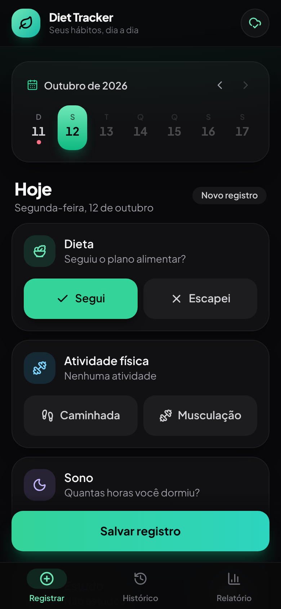
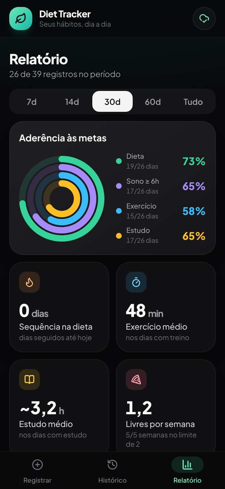
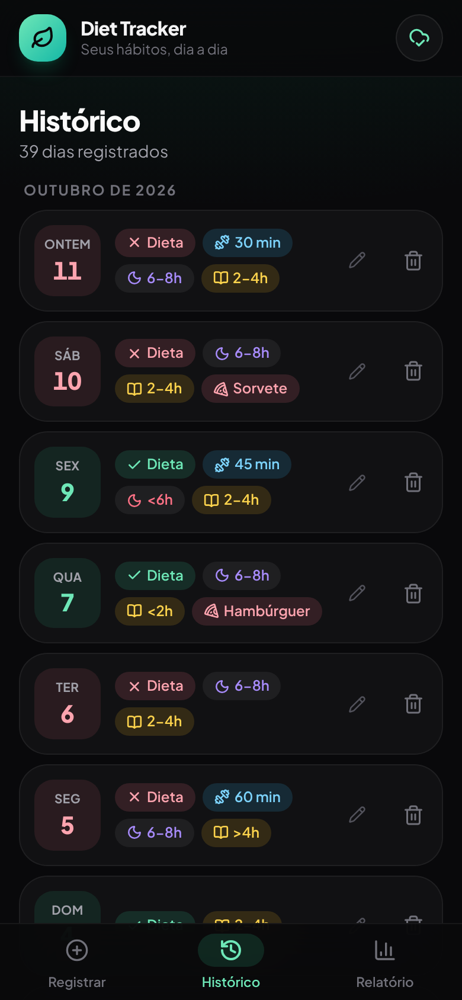

# 🥗 Diet Tracker

Aplicação web *mobile-first* para registrar hábitos diários — dieta, atividade física, sono, estudo e refeições livres — e acompanhar a evolução em relatórios e gráficos. Os dados são sincronizados com o **Firebase Realtime Database**, o que permite compartilhá-los com um(a) nutricionista, e podem ser exportados em CSV.

<p align="center">
  
  
  
</p>

<sub>Capturas com dados de exemplo.</sub>

## Sumário

- [Funcionalidades](#funcionalidades)
- [Tecnologias](#tecnologias)
- [Estrutura do projeto](#estrutura-do-projeto)
- [Como executar](#como-executar)
- [Configuração do Firebase](#configuração-do-firebase)
- [Sincronização e uso offline](#sincronização-e-uso-offline)
- [Modelo de dados](#modelo-de-dados)
- [Regras de cálculo dos relatórios](#regras-de-cálculo-dos-relatórios)
- [Exportação CSV](#exportação-csv)
- [Deploy](#deploy)
- [Próximos passos](#próximos-passos)

## Funcionalidades

A navegação fica na parte de baixo da tela, com três abas.

### ➕ Registrar

- **Faixa da semana** no topo para escolher o dia, com setas para semanas anteriores, botão **Hoje** e seletor de data. Um ponto embaixo de cada dia mostra se já existe registro: verde quando seguiu a dieta, rosa quando não.
- **Um registro por dia.** Ao abrir um dia já registrado, o formulário carrega os dados salvos para edição.
- **Campos:**

  | Hábito | Opções |
  |---|---|
  | Dieta | Segui / Escapei |
  | Atividade física | Caminhada ou Musculação · 30 min, 45 min ou 1 h |
  | Sono | `< 6h`, `6-8h` ou `> 8h` |
  | Estudo | Sim/não · `< 2h`, `2-4h` ou `> 4h` |
  | Refeição livre | Sim/não · o que foi comido |

- **Validação:** o app avisa quando falta a duração do exercício ou o tempo de estudo.
- **Botão de salvar fixo** na parte de baixo. Quando não há alterações, ele mostra "Tudo salvo".

### 📋 Histórico

Registros do mais recente para o mais antigo, agrupados por mês, com etiquetas coloridas por hábito. Tocar em um registro abre o dia para edição; a lixeira exclui o registro (com confirmação).

### 📊 Relatório

- **Período:** 7, 14, 30 ou 60 dias, ou todo o histórico.
- **Aderência às metas:** anéis com o percentual de dias na dieta, com sono ≥ 6h, com exercício e com estudo.
- **Números principais:** sequência de dias na dieta, média de exercício, média de estudo e refeições livres por semana.
- **Distribuições** de sono e de estudo por faixa.
- **Gráficos por dia** de sono e de exercício, com cores por categoria e rolagem horizontal.
- **Refeições livres por semana:** últimas 6 semanas, com destaque quando o limite de 2 é ultrapassado.
- **Exportação CSV**, com prévia dos 5 últimos registros.

### Outros detalhes

- Pode ser instalado na tela inicial do celular (ícone e manifesto próprios).
- O indicador no canto superior direito mostra se está tudo sincronizado, se há envio pendente ou se o app está offline. Tocar nele sincroniza na hora.
- O cabeçalho mostra a sequência atual de dias na dieta.

## Tecnologias

| Camada | Ferramenta |
|---|---|
| UI | [React 18](https://react.dev/) |
| Build / dev server | [Vite 4](https://vitejs.dev/) + `@vitejs/plugin-react` |
| Estilo | [Tailwind CSS 3](https://tailwindcss.com/) + PostCSS + Autoprefixer, fonte [Plus Jakarta Sans](https://fonts.google.com/specimen/Plus+Jakarta+Sans) |
| Ícones | [Lucide](https://lucide.dev/) (`lucide-react`) |
| Gráficos | [Recharts 2](https://recharts.org/) |
| Persistência | [Firebase Realtime Database](https://firebase.google.com/docs/database) (API REST via `fetch`) + `localStorage` |
| Testes | Executor de testes nativo do Node (`node --test`) |

Não há SDK do Firebase nem backend próprio: o app se comunica diretamente com o endpoint REST do banco.

## Estrutura do projeto

```
diet-tracker/
├── index.html                 # HTML de entrada, meta tags para celular, fonte e manifesto
├── public/                    # Favicon, ícones do app e manifest.webmanifest
├── docs/screenshots/          # Capturas usadas neste README
└── src/
    ├── main.jsx               # Ponto de entrada do React
    ├── App.jsx                # Layout, navegação, sincronização e avisos
    ├── config.js              # URL do Firebase e ID do usuário
    ├── index.css              # Estilos globais (tema escuro)
    ├── components/
    │   ├── EntryForm.jsx      # Aba Registrar
    │   ├── WeekStrip.jsx      # Faixa da semana do formulário
    │   ├── HistoryView.jsx    # Aba Histórico
    │   ├── ReportView.jsx     # Aba Relatório (carregada sob demanda)
    │   ├── DailyBarChart.jsx  # Gráfico de barras por dia
    │   ├── ui.jsx             # Componentes visuais reutilizáveis (cartões, botões, anéis…)
    │   └── theme.js           # Cores e ícones de cada hábito
    └── lib/                   # Lógica sem interface, coberta por testes (*.test.js)
        ├── storage.js         # Firebase + cópia local + fila de envios pendentes
        ├── stats.js           # Filtros por período, médias, semanas, sequência, dados dos gráficos
        ├── dates.js           # Datas locais (AAAA-MM-DD)
        ├── csv.js             # Geração e download do CSV
        └── constants.js       # Opções dos campos e limite de refeições livres
```

## Como executar

**Pré-requisitos:** Node.js 18 ou superior e npm (os testes usam o executor nativo do Node 20+).

```bash
npm install        # instala as dependências
npm run dev        # servidor de desenvolvimento em http://localhost:5173
npm test           # roda os testes
npm run build      # build de produção (pasta dist/)
npm run preview    # serve o build localmente
```

Para abrir no celular durante o desenvolvimento, use `npm run dev -- --host` e acesse o IP da máquina pela rede local.

> **Atenção:** `npm run dev` usa o mesmo banco do app publicado. Para testar sem mexer nos dados reais, aponte para outro banco ou outro usuário com as variáveis de ambiente abaixo.

## Configuração do Firebase

Os valores ficam em `src/config.js` e podem ser sobrescritos por variáveis de ambiente, em um arquivo `.env.local` (fora do Git) ou no painel da Vercel:

```bash
VITE_FIREBASE_DATABASE_URL=https://<seu-projeto>-default-rtdb.firebaseio.com
VITE_USER_ID=<seu-id>
```

Quem usar o mesmo `USER_ID` (por exemplo, o(a) nutricionista) verá os mesmos dados. Os registros ficam em `/users/{USER_ID}/entries/{id}`.

As variáveis de ambiente facilitam trocar de banco, mas não escondem os valores: eles continuam visíveis no código publicado.

> ⚠️ **Segurança:** as requisições são feitas **sem autenticação**. Para o app funcionar, as regras do banco precisam permitir leitura e escrita públicas nesse caminho, ou seja, qualquer pessoa que descubra a URL e o `USER_ID` pode ler, alterar ou apagar os dados. Veja [Próximos passos](#próximos-passos).

## Sincronização e uso offline

- Ao abrir o app, ele envia o que estiver pendente e baixa os registros da nuvem.
- Cada registro é gravado ou excluído **individualmente** (`PUT`/`DELETE` em `/entries/{id}.json`). Assim, um aparelho com dados antigos não apaga registros criados em outro.
- Se a gravação falhar por falta de conexão, a alteração vai para uma **fila no `localStorage`** e o indicador mostra "Pendente". A fila é reenviada quando a internet volta, quando o app é reaberto ou quando você toca no indicador.
- Sem conexão, o app mostra a última cópia salva no aparelho.

## Modelo de dados

Exemplo de registro:

```json
{
  "id": "2026-01-10-1736557200000",
  "date": "2026-01-10",
  "diet": true,
  "exercise": "Musculação",
  "exerciseMinutes": 60,
  "sleepCategory": "6-8h",
  "sleepOk": true,
  "cheatMeal": true,
  "cheatMealDesc": "Pizza",
  "studied": true,
  "studyHours": "2-4h",
  "updatedAt": "2026-01-10T22:00:00.000Z"
}
```

| Campo | Tipo | Descrição |
|---|---|---|
| `id` | string | `{data}-{timestamp}`; é também a chave no Firebase. Editar um dia mantém o mesmo `id` |
| `date` | string | Data local no formato `AAAA-MM-DD` |
| `diet` | boolean | Seguiu a dieta |
| `exercise` | string \| null | `Caminhada`, `Musculação` ou `null` |
| `exerciseMinutes` | number | `0`, `30`, `45` ou `60` |
| `sleepCategory` | string | `<6h`, `6-8h`, `>8h` ou vazio |
| `sleepOk` | boolean | `true` se o sono foi `6-8h` ou `>8h` |
| `cheatMeal` | boolean | Teve refeição livre |
| `cheatMealDesc` | string \| null | Descrição da refeição livre |
| `studied` | boolean | Estudou no dia |
| `studyHours` | string \| null | `<2h`, `2-4h` ou `>4h` |
| `updatedAt` | string | Data e hora (ISO 8601) da última gravação |

## Regras de cálculo dos relatórios

- **Período:** "últimos N dias" inclui hoje; 7 dias são hoje e os 6 anteriores.
- **Dia com exercício:** `exerciseMinutes > 0`. A média de exercício considera só esses dias.
- **Sono adequado:** faixa `6-8h` ou `>8h`.
- **Média de estudo:** faixas convertidas em horas aproximadas (`<2h` → 1, `2-4h` → 3, `>4h` → 5), considerando só os dias com estudo.
- **Semanas:** começam no domingo. Uma semana fica dentro do limite quando tem **no máximo 2** refeições livres. Só entram na conta as semanas com algum registro.
- **Sequência na dieta:** dias seguidos com dieta cumprida até hoje. Se hoje ainda não foi registrado, conta a partir de ontem; um dia sem registro interrompe a sequência.

## Exportação CSV

O botão **Baixar CSV**, no fim do relatório, baixa os registros do período selecionado no arquivo `dieta_{USER_ID}_{AAAA-MM-DD}.csv`, com as colunas:

`Data, Dieta, Exercício, Minutos, Sono, Estudou, Horas Estudo, Cheat Meal, Descrição`

O arquivo é gerado em UTF-8 com BOM, para que os acentos apareçam corretamente no Excel.

## Deploy

O app é publicado na Vercel a partir do GitHub. `npm run build` gera um site estático em `dist/`, que também pode ir para qualquer outra hospedagem estática (Firebase Hosting, Netlify, GitHub Pages etc.). Se o app for servido em um subcaminho (por exemplo, `usuario.github.io/diet-tracker/`), configure a opção [`base`](https://vitejs.dev/config/shared-options.html#base) no `vite.config.js` e ajuste `start_url` e `scope` em `public/manifest.webmanifest`.

## Próximos passos

### Feito

- [x] Gravação registro a registro, com fila offline (antes, a coleção inteira era regravada e podia apagar dados).
- [x] Data de hoje calculada no fuso local (antes, depois das 21h já aparecia o dia seguinte).
- [x] Correções: sono vazio aparecia como "> 8h", desmarcar o exercício mantinha a duração, CSV não escapava aspas, períodos contavam um dia a mais, exclusão não avisava falhas, favicon inexistente.
- [x] Edição de dias já registrados e validação do formulário.
- [x] Código dividido em componentes e módulos de lógica com testes.
- [x] Nova interface, acessibilidade (botões reais, `aria-label`, zoom liberado), ícone e manifesto para a tela inicial.
- [x] Relatório carregado sob demanda (pacote inicial de ~540 kB para ~190 kB).
- [x] `.gitignore`, `package-lock.json`, `"type": "module"` e configuração por variáveis de ambiente.

### A fazer

- [ ] **Proteger o banco.** Adotar o Firebase Authentication (login com Google, por exemplo) e restringir as regras para que cada usuário acesse só `users/$uid`, com acesso somente de leitura para o(a) nutricionista. Exige mudanças no console do Firebase.
- [ ] **Funcionar offline também ao abrir o app**, com um *service worker* (por exemplo, `vite-plugin-pwa`). Hoje a fila offline cobre gravações, mas o app precisa de internet para carregar.
- [ ] **Atualizar as dependências**, que estão com versões *major* defasadas (Vite, React, Recharts e Tailwind). O `npm audit` aponta vulnerabilidades apenas em ferramentas de desenvolvimento, que não entram no app publicado.
- [ ] Configurar ESLint e Prettier e um pipeline de CI (GitHub Actions) com build e testes.
- [ ] Visão somente leitura para o(a) nutricionista e metas configuráveis (limite de refeições livres, sono mínimo etc.).

## Licença

Ainda não definida.
